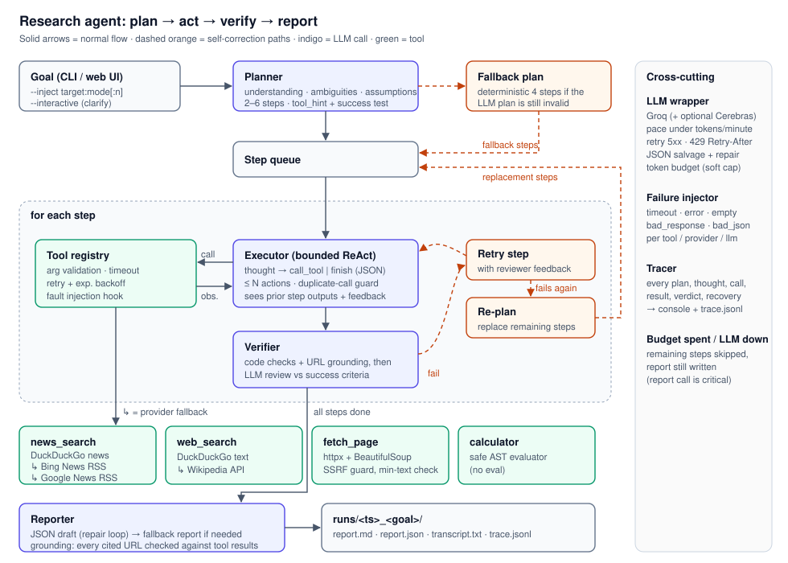
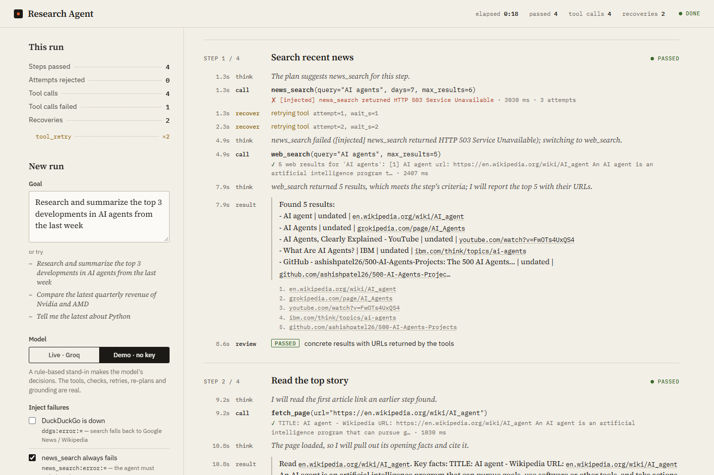

# Research Agent: plan → act → verify → report

An autonomous research agent. It takes a natural-language goal, breaks it into a visible plan, and uses live tools to carry the plan out. It checks each step and corrects itself when tools or the LLM fail. The result is a structured Markdown/JSON report where every cited URL is checked against what the tools actually returned.

```
python -m research_agent "Research and summarize the top 3 developments in AI agents from the last week"
```

- **LLM:** Groq (`openai/gpt-oss-120b` by default) through the OpenAI SDK. Any OpenAI-compatible endpoint works.
- **Tools:** `news_search`, `web_search`, `fetch_page`, `calculator`. They are live, need no API keys and have fallback providers.
- **Failure injection:** any tool, search provider or the LLM can be made to fail on demand with `--inject`.
- **Output:** every run saves `report.md`, `report.json`, `transcript.txt` (the console trace) and `trace.jsonl` (one event per line).
- **Web UI:** `python -m research_agent.web` streams the plan, tool calls, reviews, recoveries and report to the browser as they happen. Its demo mode runs without an API key.



---

## Quick start

Requires Python 3.10+.

```powershell
python -m venv .venv
.venv\Scripts\activate                    # macOS/Linux: source .venv/bin/activate
pip install -r requirements.txt
copy .env.example .env                    # then put your key in GROQ_API_KEY (free: https://console.groq.com/keys)

python -m research_agent "Research and summarize the top 3 developments in AI agents from the last week"
```

Other ways to run it:

```powershell
# Deliberately break things: the primary search provider is down for the whole run,
# and the first page fetch times out.
python -m research_agent "Top 3 AI agent developments this week" --inject "ddgs:error:*" --inject fetch_page:timeout:1

# Ask the user when the goal is ambiguous (otherwise the agent states an assumption and proceeds)
python -m research_agent "Tell me the latest about Python" --interactive

python -m research_agent --list-faults         # all injection modes
python -m research_agent "AI agents this week" --demo    # no API key: rule-based stand-in for the LLM, live tools
python -m research_agent.web                   # web UI on http://127.0.0.1:8000 (see below)
pytest                                         # 225 offline tests, ~15 s
```

### Web UI

```powershell
python -m research_agent.web                   # then open http://127.0.0.1:8000  (--port to change)
```

Type a goal, choose which failures to inject, and watch the run. Each step appears as a card showing the model's thoughts, every tool call with its latency and result, the step's output with its sources, and the reviewer's verdict. Retries, provider switches, JSON repairs and re-plans appear inline where they happened, and the plan's step list updates as steps pass, fail or are replaced. The run ends with the report, where each cited URL is marked ✓ verified or ✗ unverified, and download links. The page reads the same tracer events that go into `trace.jsonl`, and each run is saved under `runs/` just as the CLI saves it.



- **Demo mode** (`--demo` on the CLI) needs no API key. A rule-based stand-in ([demo.py](research_agent/demo.py)) makes the model's decisions: it searches with the step's suggested tool, switches tools when one fails, cites only URLs a tool returned, and ranks by date. Everything else is the agent's real code: the control loop, live tools, verifier, retries, re-plans and grounding. Its prose is plain and its report is always *low* confidence. It shows the machinery, not LLM quality.
- **Scope:** one run at a time. The server uses only the standard library (`http.server` plus Server-Sent Events) and listens on 127.0.0.1 only. It rejects requests addressed to any other host name (DNS rebinding) and accepts only JSON POSTs, so another web page can't start runs with your key.

To generate the sample transcripts: `powershell -ExecutionPolicy Bypass -File scripts\run_samples.ps1`, or `sh scripts/run_samples.sh` on macOS/Linux. The runs are written to [runs/samples/](runs/samples/). Four committed runs are indexed, with notes on what each one shows, in [runs/samples/README.md](runs/samples/README.md).

---

## How it works

| Phase | What happens | Where |
|---|---|---|
| **Plan** | The LLM restates the goal and lists **ambiguities** and **assumptions**. It then writes 2–6 steps, each with a `tool_hint` and a checkable `success_criteria`. The plan is validated, and unknown tools or a bad step count trigger a JSON repair. If the goal is ambiguous and `--interactive` is set, the agent asks the user and re-plans. | [planner.py](research_agent/planner.py) |
| **Act** | Each step runs a bounded ReAct loop. The LLM returns JSON `{thought, action: call_tool\|finish, …}` and the tool result is fed back as an observation. The loop is capped at N actions, after which the agent is forced to summarise. Repeated identical calls are blocked. | [executor.py](research_agent/executor.py) |
| **Verify** | Deterministic checks run first: the output is non-trivial, at least one tool call succeeded, a tool was used when the step needs one, and every URL the step cites was returned by a tool during the run. An LLM reviewer then judges the output, together with the URLs the step cites, against the step's success criteria. | [verifier.py](research_agent/verifier.py) |
| **Correct** | If a step fails, it is retried once with the reviewer's feedback. If it fails again, the remaining plan is replaced with a new one that accounts for what went wrong. | [agent.py](research_agent/agent.py) |
| **Report** | The LLM drafts the report as JSON, using a repair loop and falling back to a mechanical report if needed. **Grounding** marks each cited URL `verified` only if a tool returned it during this run. The writer is shown only URLs that tools returned, and code caps the LLM's confidence: at **low** if fewer than half the steps passed review or fewer than half the cited URLs are verified, and at **medium** if a finding is dated outside the window the goal asks for ("last week" means 7 days). The report also records the plan, assumptions, every recovery and the run statistics. | [reporter.py](research_agent/reporter.py) |

The planning trace is shown live in the console. Each plan appears as a table, and each step shows the thought, tool call, result, reviewer verdict and any `↻ RECOVERY` lines. The same events, including each step's full output and cited sources, are saved in `trace.jsonl` so the run can be audited afterwards. The web UI renders these same events.

### Tools

| Tool | Primary | Fallback | Notes |
|---|---|---|---|
| `news_search(query, days, max_results)` | DuckDuckGo News (`ddgs`) | Bing News RSS, then Google News RSS | Drops items older than `days` and duplicate titles; newest first |
| `web_search(query, max_results)` | DuckDuckGo text | Wikipedia search API | Background, definitions and official pages |
| `fetch_page(url, max_chars)` | httpx + BeautifulSoup | – | Up to 3 URLs per call, fetched in parallel: one LLM turn reads them all, and a page that fails is reported without losing the others. Prefers `<article>`/`<main>`. Refuses local and private addresses, checked after DNS resolution and again on every redirect (SSRF guard), and stops downloading at 3 MB. Rejects pages with too little text or that aren't HTML. Reports the publication date (`PUBLISHED:`) when the page's metadata has one. A reader-proxy URL (`r.jina.ai/<url>`, which refuses requests without a key) is read from the publisher directly |
| `calculator(expression)` | AST evaluator | – | No `eval`. Understands `1,250`, `15%` and `^`. Exponents and result sizes are bounded |

All tools go through a single [ToolRegistry](research_agent/tools/base.py), which handles:
- argument validation and coercion;
- a hard timeout on every call, run in a worker thread;
- classifying errors as transient (timeouts, 5xx, 429) or permanent (4xx, bad arguments);
- retrying transient errors with exponential backoff;
- checking the output is valid.

The registry **never raises**. A failed call comes back to the LLM as an observation such as `FAILED after 3 attempt(s): …`, so the model can pick another tool or query.

### Failure handling: every layer

| Failure | Detection | Recovery | Trace label |
|---|---|---|---|
| Tool timeout, 5xx or 429 | exception classification | retry with backoff, up to 2 extra attempts | `tool_retry` |
| A page doesn't answer (news sites that hold off bots stall rather than refuse) | no reply within 10 s | not retried, since a retry only waits again (one live run lost 49 s that way); the model is told to use the search snippet or another source | – |
| One search provider down | provider raises | same tool switches to its fallback provider | `provider_fallback` |
| A news provider answers a "past week" query with mostly older stories | fewer than 3 results left inside the window | topped up from the next provider | `provider_fallback` |
| Tool fails every retry | `ok=false` result | error goes back to the LLM, which usually switches tools or queries | – |
| Malformed tool output | output validation | treated as transient and retried | `tool_retry` |
| Zero results | `No news found…` observation (DuckDuckGo's `No results found.` error counts as an empty answer, not an outage, so it isn't retried) | the LLM rephrases the query or switches tool; the verifier fails the step if nothing is found | – |
| LLM emits invalid JSON or schema | pydantic validation | validation error sent back to the LLM, up to 2 repairs | `json_repair` |
| Executor reply omits `action` or puts the tool name in it (common on gpt-oss-20b) | pydantic `before` validator | action inferred from `tool`/`output`, no LLM call spent. Replies in other shapes still cost a JSON repair (13–16 per eval run on 20b), and each `json_repair` event now logs the raw reply so those shapes can be found | – / `json_repair` |
| LLM calls an unknown tool | registry lookup | corrective observation that lists the valid tools | `invalid_action` |
| LLM repeats the same call | call signature cache | blocked, and told to change the query | `duplicate_call` |
| LLM never finishes a step | action counter | forced "finish now" turn, then salvage | `forced_finish` |
| A step lists items no tool returned (asked for 5 news items when the search found 1, the model writes 4 more from memory) | every URL the step cites is checked against the URLs tools returned in the run | the step fails without asking the reviewer; the retry is told which URLs to drop and to search again | `step_retry` |
| Step output weak or unsupported | verifier (it also sees the first line of each tool result, e.g. `1 news result for …`) | re-run the step with reviewer feedback | `step_retry` |
| Step still fails | verifier | re-plan the remaining work, once | `replan` |
| Planner can't produce a valid plan | repairs exhausted | deterministic fallback plan | `fallback_plan` |
| Report writer fails | repairs exhausted | fallback report assembled from step outputs | `fallback_report` |
| Report cites a URL no tool returned (invented) | grounding check against every URL tools returned | URL flagged ⚠️ unverified; if under half are verified, a limitation is added and confidence is capped at low | – |
| Report cites an old story as "this week" | finding date vs. window parsed from the goal | finding flagged, limitation added, confidence capped at medium | – |
| Most steps failed, but the report still sounds sure | steps passed vs. steps run | limitation added, confidence capped at low | – |
| LLM 5xx, timeout or connection error | exception type | retry with backoff | `llm_retry` |
| Next call would exceed tokens-per-minute | a token bucket per model that mirrors Groq's (refills continuously, charged with the tokens actually used, corrected from the `x-ratelimit-*` headers of every reply) | wait only until the bucket has room for this request, *before* sending | `llm_throttle` |
| Reply cut off at `max_tokens` | `finish_reason == "length"` | ask again once with double the room (up to 4096); if the JSON is still cut off, the repair asks for a shorter reply | `llm_truncated` |
| Review model not available on this account | 404 on the second model | review on the main model for the rest of the run | `model_fallback` |
| Optional second provider (Cerebras) fails a call | any API error from it | the call goes to Groq at once, without spending a retry. A 429 rests Cerebras until `Retry-After`. A request too long for its context window is not sent to it again at that size. A field it rejects (e.g. JSON mode) is dropped for later calls. A bad key, or two unexplained failures in a row, switches it off for the run | `lane_fallback`, `lane_disabled` |
| Groq rate limit (429) anyway | `RateLimitError` | wait for `Retry-After` (own allowance of 10 waits, separate from error retries) | `llm_rate_limit` |
| Reasoning model leaves `content` empty | empty reply | take the last JSON object from the model's reasoning field | `reasoning_salvage` |
| Provider JSON mode rejects the reply (`json_validate_failed`) | 400 error | switch to plain mode for the rest of the run; parsing + repair still apply | `json_mode_off` |
| LLM stays unavailable (daily quota, outage) | retries exhausted | skip remaining steps; report is still written from what was gathered | `llm_unavailable` |
| Token budget spent | usage counter | skip remaining steps; the report still gets written | `budget` |
| Bad API key or model name | 401/404 | fail fast with an actionable message, no retries | – |

### Deliberate failure injection

`--inject TARGET:MODE[:COUNT]` can be repeated. COUNT defaults to 1, and `*` means every call. An unknown target, mode or count is refused rather than silently ignored.

| | |
|---|---|
| Targets | `news_search`, `web_search`, `fetch_page`, `calculator` (whole tool); `ddgs`, `bing_news`, `google_news`, `wikipedia` (a single provider inside a tool); `llm` |
| Modes | `timeout`, `error` (HTTP 503), `bad_response` (malformed payload), `empty` (zero results), `bad_json` (truncates the LLM reply; `llm` only) |

Injected faults use the same code paths as real faults, and are listed in the report under `execution.injected_faults`.

---

## Project layout

```
research_agent/
  cli.py          argument parsing, run directory, artefacts
  agent.py        orchestration: plan → step queue → retry / replan → report
  planner.py      plan + replan (+ deterministic fallback plan)
  executor.py     per-step bounded ReAct loop
  verifier.py     deterministic checks + LLM reviewer
  reporter.py     report drafting, source grounding, Markdown rendering
  llm.py          Groq/OpenAI client wrapper: per-model TPM pacing, optional second provider, retries,
                  rate limits, JSON salvage/repair, budget
  prompts.py      all prompts in one place
  models.py       pydantic schemas for every LLM output
  failures.py     fault injection
  trace.py        console trace + trace.jsonl / transcript.txt, event listeners
  tools/          base registry + search, fetch, calculator
  demo.py         rule-based stand-in for the LLM (--demo, web UI demo mode)
  web.py          web UI server: stdlib http.server + Server-Sent Events
  static/         the web UI page (one HTML file, no build step)
tests/            171 offline tests (scripted LLM + fake tools), plus 54 for the legacy app's fast path
evals/            goal set + metrics runner
scripts/          sample-run generators, offline demo
docs/             architecture diagram, write-up, web UI screenshot
runs/samples/     committed sample transcripts
legacy/           the earlier Flask "MyAgent" app this project started from; not part of the agent
```

## Testing and evaluation

- `pytest` runs 171 agent tests offline; with the legacy tests below, the suite takes about 15 seconds. A `ScriptedClient` stands in for the OpenAI SDK, returning a queue of replies for each role (planner, executor, reviewer, reporter). The tests cover:
  - every recovery path listed above, end to end;
  - the tools: parsing, date filtering, the SSRF guard, calculator safety, retry and timeout behaviour, and fault parsing (a misspelt target is refused);
  - the web server on a real local port: event streaming and resume, one run at a time, bad requests, and the host, content-type and content-length guards;
  - demo mode, driven through the real agent loop.
  
  `tests/test_fast_path.py` adds 54 tests for the legacy app.
- `python -m evals.run_evals [--only id,...] [--budget 40000]` runs the goals in [evals/goals.json](evals/goals.json), some of them with injected faults. It writes a summary table to `evals/results/<ts>/summary.md` with these columns:
  - plan size
  - steps passed
  - number of findings
  - recoveries, by kind
  - grounding rate
  - confidence
  - tokens and seconds

### Eval results so far

[evals/results/20260923-192413/](evals/results/20260923-192413/summary.md) covers two goals on gpt-oss-20b with a 40K budget. The other three goals in the set are the same as the committed [sample runs](runs/samples/README.md).

| Goal | Injected | Steps passed | Grounding | Confidence | What happened |
|---|---|---|---|---|---|
| compare-numbers | – | 4 / 5 | 1.0 | low | Steps 1–4 passed. Step 5 was rejected because it did no tool call, and the budget ran out before its retry. The run had 13 JSON repairs. |
| llm-garbage | `llm:bad_json:2` | 0 / 4 | 1.0 | medium* | The planner gave 1-step plans until its repairs ran out, so the fallback plan was used. Step 1 was rejected twice ("no URLs"), then the agent re-planned. The budget ran out in step 5. The run had 18 JSON repairs (2 of them from the injected fault) and 22 real 429s. |

These runs led to five fixes, each with a test:
1. **The reviewer now sees the URLs a step cites.** Before, it saw only the output text, so a result whose URLs were in its `sources` field could be rejected for "no URLs". The traces can't show how many rejections this caused, because step outputs weren't logged yet (see fix 2).
2. **Each step's output and sources are now in `trace.jsonl`** (`step_output` events).
3. **Each `json_repair` event now logs the first 300 characters of the raw reply.** The 29 executor repairs in these runs were all `action: Field required`, in a reply shape the inference doesn't cover yet. The logged replies will show which shape it is.
4. **Pacing counted only the tokens a call used.** Groq admits a request only if `prompt + max_tokens` fit, so pacing now checks that before each call. This targets llm-garbage's 22 rate-limit waits. (A later change replaced the sliding window with a token bucket synced to Groq's headers; see [Configuration](#configuration).)
5. **\*Confidence is now capped at low when fewer than half the steps pass.** llm-garbage reported *medium* with 0 of 4 steps passed.

The eval set hasn't been re-run since these fixes: the free tier's daily quota went to the live runs below, which use the brief's own goal.

### Live runs on 26 Sep

Four runs of the brief's goal on gpt-oss-120b. Each run showed a problem, which was fixed and tested before the next run.

| Run | Time | Steps passed | Grounded URLs | What went wrong | Fix |
|---|---|---|---|---|---|
| 1 | 386 s | 2 / 5 | 1 / 3 | DuckDuckGo returned 1 story from the past week for a "top 5" step. The model listed 4 more from memory, with invented URLs, and the reviewer passed the step. Three later steps chased the invented stories. The report's grounding check still caught it: 1 of 3 URLs verified, confidence capped at low. | Every URL a step cites is checked in code; `news_search` tops up from the next provider when fewer than 3 fresh results remain |
| 2 | 400 s | 2 / 5 | 4 / 4 | The plan required the "full readable text" of 3 articles. msn.com pages are drawn by JavaScript, nytimes.com returned 403, and washingtonpost.com stalled for 49 s over 3 attempts. The model then tried the `r.jina.ai` reader proxy 5 times (403 each time), and the token budget ran out. | A page that stalls isn't retried; proxy URLs are read from the publisher directly; the planner and re-planner are told not to make success depend on the full text of particular pages |
| 3 | stopped | – | – | A step read all 3 pages, and the reviewer failed it twice because its output "only summarised" them. | The reviewer is told that step results are short by design |
| 4 | 228 s | 3 / 3 | 3 / 3 | Nothing lost: the URL check caught a URL the model had cut short, and the retry cited the full one. | – ([sample 4](runs/samples/README.md)) |

## Configuration

All settings are environment variables and can go in `.env`; see [.env.example](.env.example). The main ones are `GROQ_API_KEY`, `GROQ_MODEL`, `LLM_BASE_URL`, `TOKEN_BUDGET` (default 60K) and `MAX_ACTIONS_PER_STEP`.

**Groq free tier.** `openai/gpt-oss-120b` is limited to 8K tokens a minute and 200K tokens a day, and each model has its own quota. A run of the brief's goal uses 40–65K tokens, so on the free tier its length is set by the minute limit: about one minute per 8K tokens, plus search and page loads. The daily limit allows three or four runs per model.
- **Pacing.** The LLM wrapper mirrors Groq's limit as a token bucket that refills continuously. A request is admitted when its prompt + `max_tokens` fit, and the unused part of `max_tokens` is handed back when the call ends. The mirror is corrected from Groq's `x-ratelimit-*` response headers, so it also accounts for another run on the same key. When a call would not fit, the wrapper waits just long enough before sending it (`llm_throttle`) instead of collecting a 429.
- **Fewer tokens is the only way to go faster**, so the agent:
  - reads up to 3 pages in one `fetch_page` call;
  - tells the executor to stop as soon as a step's criteria are met;
  - asks the planner for minimal criteria and 2–4 steps;
  - reviews steps on `GROQ_REVIEW_MODEL` (default `openai/gpt-oss-20b`), whose separate minute limit keeps reviews from queueing behind the executor.

  Before these changes, a 6-step news goal took 818 s, 756 s of it waiting on the minute limit: the old sliding-window pacer often held a call for close to a minute. After the first round, which also brought the token bucket, it took 355 s (308 s waiting). With the final code it took 228 s (42K tokens, at least 180 s waiting). The two runs just before that took 386 s and 400 s: failed steps, retries and a re-plan used up the 60K token budget ([live runs](#live-runs-on-26-sep)).
- If your account has higher limits, pacing follows the `x-ratelimit-limit-tokens` header. `LLM_TPM_LIMIT` sets the starting value, and `0` turns pacing off.
- **Optional second provider.** Cerebras' free tier serves the same `gpt-oss-120b` with limits of its own: 30K tokens and 5 requests a minute. Setting `CEREBRAS_API_KEY` in `.env` gives it its own token bucket and 60-second request window. Each main-model call then goes to whichever provider can take it sooner, and reviews stay on Groq's 20b. When Cerebras fails, only that call is affected: it goes to Groq instead (see the failure table). Without the key nothing changes.
  - On paper it more than doubles how many main-model calls fit in a minute.
  - The routing and every fallback are covered by offline tests with scripted clients.
  - The speed-up hasn't been measured live, because this project was built without a Cerebras key.
- **Other models.** `openai/gpt-oss-20b` is a drop-in alternative with a separate daily quota (`--model openai/gpt-oss-20b`). `qwen/qwen3.8-27b` also works, but it is capped at 1,000 *output* tokens a minute, which makes it much slower. See [console.groq.com/docs/models](https://console.groq.com/docs/models) for current names and limits.

gpt-oss is a reasoning model. Now and then it writes its JSON into the `reasoning` field and leaves `content` empty, which makes Groq's JSON mode fail. The wrapper recovers the JSON from the reasoning, and after the first such failure it stops using JSON mode for the rest of the run. Both recoveries appear in the trace. `REASONING_EFFORT` (default `low`) keeps the hidden reasoning, which is also billed, short.

## Assumptions, mocks and data sources

- **No dataset is used.** All data comes live from DuckDuckGo, Bing News RSS, Google News RSS, Wikipedia and the fetched pages. No search API keys are needed.
- **"Last week" means the last 7 days**, measured on the machine's clock. Undated items are kept but sorted last.
- **The only stand-ins are the test fakes in `tests/` and demo mode.** Demo mode ([demo.py](research_agent/demo.py)) replaces the LLM with rules and uses the live tools. Its report names the model as `demo (rule-based stand-in, no LLM)` and has *low* confidence.
- **Some pages can't be read.** Google News result links (the last-resort news provider) are redirect pages, and some sites block bots or need JavaScript. `fetch_page` reports these clearly, and the agent falls back to the search snippets.
- **Recency is checked only for ISO dates.** A finding whose date the LLM wrote in another format is not flagged.
- **The report only claims grounding, not correctness.** A `verified` source means a tool really returned that URL in this run; it does not mean every sentence is supported by it.

See [docs/WRITEUP.md](docs/WRITEUP.md) for design decisions, limitations and future work.
